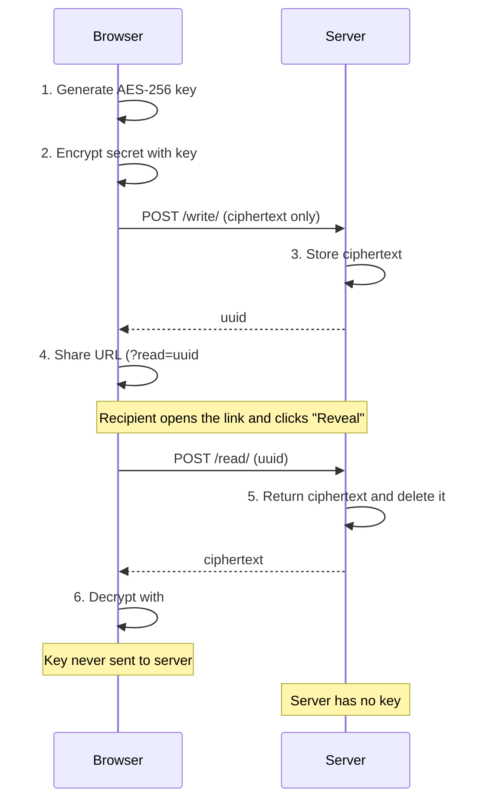

# Simple-OTS

A lightweight and secure "One Time Secret" solution for sharing sensitive information safely.


## Features

- **Zero-Knowledge Encryption**: Secrets are encrypted client-side using AES-256-GCM before leaving your browser. The server never sees the plaintext.
- **One-Time Access**: Secrets are automatically deleted after being viewed
- **Expiration Times**: Set secrets to expire after 1 hour, 1 day, or 1 week
- **Simple Interface**: Clean, dark-themed Bootstrap UI
- **Multilingual**: English, Spanish and Chinese, picked automatically from the browser's language
- **Copy Functionality**: Easy copy buttons for both secret links and content
- **Access Control**: Optional IP/CIDR allow-list for creating secrets
- **Docker Ready**: Quick deployment with Docker and Docker Compose
- **SQLite Backend**: Lightweight database with no additional dependencies

## Security

### In-Transit Protection
Configure your reverse proxy (e.g., nginx, Caddy, Traefik) with TLS 1.3 for strong transport security.

HTTPS is also required for the app to work: browsers only expose the Web Crypto API on secure origins (HTTPS or `localhost`). Over plain HTTP the page shows an error instead of creating or opening secrets.

### At-Rest Protection

Simple-OTS implements **zero-knowledge encryption**:

1. **Client-Side Encryption**: Secrets are encrypted in your browser using AES-256-GCM with a randomly generated 256-bit key
2. **Key Separation**: The encryption key is stored in the URL fragment (`#key`), which is never sent to the server
3. **Server Blindness**: The server only stores encrypted ciphertext - it cannot decrypt your secrets even if compromised
4. **Automatic Cleanup**: Expired secrets are automatically purged from the database

### Additional Security Measures

- **Preview-Safe Links**: Opening a link only shows a "Reveal secret" button; the secret is consumed by an explicit POST, so chat link previews, crawlers and browser prefetching can't burn it
- **CSRF Protection**: Secret creation is protected against cross-site request forgery
- **Rate Limiting**: Prevents brute-force attacks on secret UUIDs (30 requests per 5 minutes per IP)
- **Security Headers**: Strict CSP (no inline scripts), X-Frame-Options, X-Content-Type-Options, Referrer-Policy, `Cache-Control: no-store`
- **Subresource Integrity**: CDN assets are version-pinned and verified with SRI hashes
- **Secure Sessions**: HTTP-only, SameSite=Strict cookies
- **Input Validation**: UUID format validation, expiry whitelisting, and the server rejects anything that isn't AES-GCM ciphertext (so plaintext can never be stored by mistake)

### How Zero-Knowledge Works



## Usage

### Quick Start

The easiest way to get started is using Docker:

```bash
# Pull the image
docker pull roura/simple-ots

# Run the container
docker run -p 80:80 roura/simple-ots
```

Or using the provided Docker Compose file:

```bash
# Clone the repository
git clone https://github.com/rouralberto/simple-ots.git
cd simple-ots

# Start the service
docker-compose up -d
```

Then navigate to `http://localhost` in your browser.

### Creating a Secret

1. Enter your sensitive information in the "Secret" field
2. Select an expiration time (1 hour, 1 day, or 1 week)
3. Click "Create secret link"
4. Copy the generated link and send it to the intended recipient (don't open it yourself)

### Viewing a Secret

1. Open the shared URL
2. Click "Reveal secret"
3. The secret will be displayed only once and then permanently deleted
4. Use the copy button to safely copy the content to your clipboard

**Important**: The entire URL including the `#key` fragment must be shared. Without the key the secret cannot be decrypted; if the key is missing, the page says so and the secret is **not** consumed.

## Configuration

### Limiting Access

To restrict who can create secrets, set the `AUTH_IPS` environment variable to a comma-separated list of allowed IP addresses or CIDR ranges. Anyone with a link can still read secrets.

```yaml
environment:
  AUTH_IPS: 1.1.1.1,8.8.8.8,10.0.0.0/8
```

### Running Behind a Reverse Proxy

By default the client IP is taken from the TCP connection and `X-Forwarded-For` is **ignored**, because any client can forge that header to bypass `AUTH_IPS` and rate limiting. If Simple-OTS sits behind a reverse proxy, list the proxy's IPs or CIDR ranges in `TRUSTED_PROXIES` so the real client IP is read from `X-Forwarded-For`:

```yaml
environment:
  TRUSTED_PROXIES: 172.17.0.0/16
```

### Languages

The interface language is chosen from the browser's `Accept-Language` header: English, Spanish or (Simplified) Chinese, falling back to English. Translations live in `html/lang/`; to add a language, copy `en.php` to `<code>.php`, translate it, and add the code to `LOCALES` in `html/common.php`.

### Persistent Storage

To persist secrets across container re-creation, mount a volume for the database (the provided `docker-compose.yml` uses a named volume):

```yaml
volumes:
  - ./data:/var/www/db
```

The container fixes the directory's ownership at start-up, so a bind-mounted host directory works too.

## Development

To set up a development environment:

```bash
# Clone the repository
git clone https://github.com/rouralberto/simple-ots.git
cd simple-ots

# docker-compose.yml already mounts ./html into the container, so edits are live
docker-compose up

# Or, without Docker: requires PHP 8.5+ with pdo_sqlite (http://localhost counts as a secure origin)
mkdir -p db && cd html && php -S localhost:8000
```

## License

This project is licensed under the terms of the LICENSE file included in the repository.

## Contributing

Contributions are welcome! Feel free to open issues or submit pull requests.
